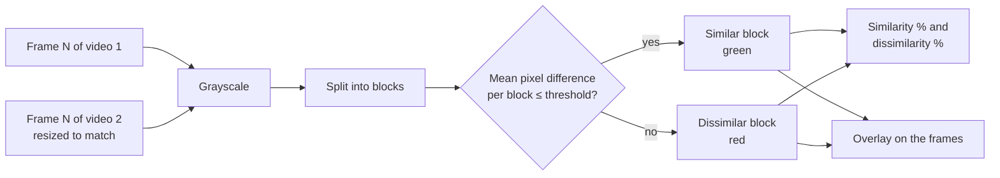

<h1 align="center">🎞️ Video Comparison Tool</h1>

<p align="center">A frame-by-frame video comparison tool that uses a block-based pixel analysis algorithm to measure similarity and dissimilarity between two videos. It highlights differences with bounding boxes and displays side-by-side frames interactively via a Gradio interface, providing real-time visual and statistical feedback to users.</p>

<p align="center">
  
  
  
  
</p>

<p align="center">
  <a href="#-how-it-works"><b>How it works</b></a> ·
  <a href="#-quick-start">Quick start</a> ·
  <a href="#-using-the-interface">Interface</a> ·
  <a href="#-tuning">Tuning</a>
</p>

---

## 🔬 How it works



1. Frames are read from both videos one pair at a time. If the sizes differ, the second frame is resized to match the first.
2. Both frames are converted to grayscale and split into square blocks.
3. For each block, the mean absolute pixel difference is compared with a threshold of **40**. At or below it, the block is *similar* (green); above it, *dissimilar* (red).
4. The share of similar and dissimilar blocks gives the **similarity %** and **dissimilarity %** for that frame.
5. The colored blocks are blended over the side-by-side frames to show exactly where they differ.

## 🚀 Quick start

```bash
pip install -r requirements.txt     # opencv-python-headless, scikit-image, gradio
python final.py
```

Open the local URL that Gradio prints. The app launches with `share=True`, so Gradio also prints a temporary public link; remove that argument in `final.py` to keep it local-only.

## 🖥️ Using the interface

1. Upload **Video 1** and **Video 2**.
2. Click **Compare & Load Videos** to load both videos.
3. Click **Next Frame** to compare the next pair of frames. You see:
   - the status (for example `Frame 3: Comparison completed.`)
   - **Similarity (%)** and **Dissimilarity (%)**
   - the raw frames side by side
   - the same frames with the block overlay

When either video runs out of frames, the status says the end was reached.

## 🎛️ Tuning

The settings are in `compare_next_frame()` in `final.py`:

| Setting | Value | Effect |
|---|---|---|
| `block_area` | `10000` | Approximate pixels per block (block side is its square root). Smaller blocks locate differences more precisely but cost more time per frame. |
| `threshold` | `40` | Maximum mean grayscale difference for a block to count as similar. Lower is stricter. |
